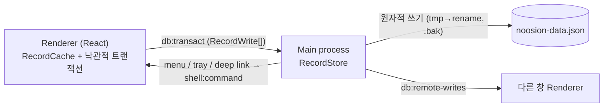

<p align="center"></p>

<h1 align="center">Noosion</h1>

<p align="center">로컬 우선(local-first)으로 동작하는 Notion 스타일 워크스페이스 데스크톱 앱<br>
페이지 · 블록 에디터 · 데이터베이스(표/보드/리스트/갤러리/캘린더/타임라인) · 탭 · 빠른 검색</p>

---

Noosion은 Notion 데스크톱 앱의 구조를 분석([docs/ANALYSIS.md](docs/ANALYSIS.md))해서 같은 사용 경험을 **서버 없이 내 PC에서** 제공하도록 처음부터 새로 만든 Electron 앱입니다.

- Notion의 코드나 에셋은 포함하지 않습니다.
- Notion, Inc.와는 관련이 없습니다.

## 주요 기능

**블록 에디터**
- 블록 타입: 텍스트, 제목 1·2·3, 글머리 기호·번호 목록, 할 일, 토글, 인용, 콜아웃, 구분선, 코드(언어 선택·줄바꿈·복사), 수식, 이미지(업로드·링크·크기 조절·캡션), 북마크(링크 미리보기), 단순 표, 2·3단 컬럼, 하위 페이지, 인라인/전체 페이지 데이터베이스
- 입력 방식
  - `/` 슬래시 메뉴(한/영 검색)
  - Markdown 단축 입력: `#` `##` `###` `-` `1.` `[]` `>` `"` ` ``` ` `---`
  - 블록 간 Enter·Backspace 분할/병합, Tab·Shift+Tab 들여쓰기
- 블록 조작: ⋮⋮ 핸들로 드래그 앤 드롭, 블록 메뉴(삭제·복제·전환·색상), `Ctrl+Alt+0~9` 블록 전환, `Ctrl+D` 복제, `Ctrl+Shift+↑/↓` 이동
- 인라인 서식 도구 모음: 굵게, 기울임, 밑줄, 취소선, 코드, 링크, 글자색·배경색
- 실행 취소/다시 실행(트랜잭션 기반, 연속 입력 병합)
- 붙여넣기: 이미지, URL(→ 북마크/이미지), 여러 줄 Markdown

**페이지**
- 아이콘(이모지 선택기), 커버(그라데이션·이미지 업로드·위치 조정)
- 글꼴(기본/세리프/모노), 작은 텍스트, 전체 너비, 페이지 잠금
- 즐겨찾기, 휴지통(복원·영구 삭제), 페이지 복제, 링크 복사, Markdown 내보내기·가져오기, 인쇄
- 이동 경로(breadcrumb), 편집 시각, 단어 수 표시

**데이터베이스**
- 속성 타입: 제목, 텍스트, 숫자(형식 지정), 선택, 다중 선택, 상태, 날짜, 체크박스, 사람, URL, 이메일, 전화번호, **수식**, 생성/최종 편집 일시
- 뷰: **표**(열 너비 조절·줄바꿈), **보드**(그룹 기준 선택·카드 드래그), **리스트**, **갤러리**, **캘린더**(날짜로 드래그), **타임라인**(막대 이동·기간 조절)
- 필터(AND/OR), 정렬, 속성 표시/숨김, 검색, 뷰 여러 개 추가·이름 변경·삭제
- 행을 열면 전체 페이지로 편집(속성 패널 + 본문)
- 수식 문법(Notion 수식의 부분 집합): `prop("이름")`, `if`, `concat`, `round`, `dateBetween`, 비교·논리·삼항 연산자 등

**데스크톱 셸** (Notion 데스크톱과 같은 구성)
- 프레임 없는 창 + 커스텀 탭 바
  - 탭: 드래그로 순서 변경, 고정, 복제, 다른 탭 닫기, 가운데 클릭으로 닫기
  - 닫은 탭 다시 열기, 뒤로/앞으로
  - 종료 후 다시 열면 세션 복원
- 사이드바: 페이지 트리 드래그 정렬, 즐겨찾기, 너비 조절
- 빠른 검색(`Ctrl+P`): 제목과 본문 전문 검색, 최근 페이지
- 여러 창 사이 실시간 동기화
- 트레이(백그라운드 유지·로그인 시 실행), 사용자 지정 전역 단축키
- `noosion://page/<id>` 딥링크, `.md` 파일 연결
- 테마(시스템/라이트/다크), 한국어/영어 UI, 맞춤법 검사
- 데이터: 워크스페이스 백업/복원, 데이터 폴더 열기, 전체 초기화

## 단축키

| 동작 | 단축키 |
|---|---|
| 빠른 검색 | `Ctrl+P` / `Ctrl+K` |
| 새 페이지 / 새 탭 / 새 창 | `Ctrl+N` / `Ctrl+T` / `Ctrl+Shift+N` |
| 탭 닫기 / 닫은 탭 다시 열기 | `Ctrl+W` / `Ctrl+Shift+T` |
| 다음·이전 탭 / N번째 탭 | `Ctrl+Tab` · `Ctrl+Shift+Tab` / `Ctrl+1…9` |
| 뒤로 / 앞으로 | `Ctrl+[` / `Ctrl+]` (또는 `Alt+←/→`) |
| 사이드바 | `Ctrl+\` |
| 링크 복사 / 페이지 이름 복사 | `Ctrl+L` / `Ctrl+Alt+L` |
| 실행 취소 / 다시 실행 | `Ctrl+Z` / `Ctrl+Shift+Z` |
| 설정 | `Ctrl+,` |
| 블록 전환 (텍스트, H1~H3, 할 일, 글머리, 번호, 토글, 코드, 페이지) | `Ctrl+Alt+0…9` |
| 굵게 / 기울임 / 밑줄 / 취소선 / 코드 / 링크 | `Ctrl+B` / `I` / `U` / `Shift+S` / `E` / `K` |

## 설치

[Releases](https://github.com/egparadise/noosion/releases) 또는 [Actions](https://github.com/egparadise/noosion/actions) 아티팩트에서 받을 수 있습니다.

- `Noosion Setup x.y.z.exe`: 설치형
- `Noosion-x.y.z-portable.exe`: 포터블

데이터는 `%APPDATA%\Noosion\noosion-data.json`에 저장됩니다.
- 저장할 때마다 원자적으로 기록하고 `.bak` 백업을 함께 남깁니다.
- 업로드한 이미지는 `files\` 폴더에 저장됩니다.

## 개발

```bash
npm install
npm run dev        # 개발 모드 (HMR)
npm run typecheck  # TypeScript 검사
npm test           # 단위 테스트 (vitest)
npm run build      # 프로덕션 번들 → out/
npm run dist       # Windows 설치 파일 + 포터블 → dist/
```

환경 변수 `NOOSION_USER_DATA=<폴더>`를 지정하면 별도 프로필로 실행됩니다(테스트용).

### 구조

```
src/
├── shared/types.ts        # 레코드 모델 (block / collection / collection_view / space)
├── main/                  # 메인 프로세스: 창·메뉴·트레이·딥링크·IPC·JSON 레코드 저장소
├── preload/               # contextBridge → window.noosion
└── renderer/src/
    ├── store/             # 레코드 캐시 + 트랜잭션/undo, 블록 연산, UI 상태(탭)
    ├── editor/            # contentEditable 블록 에디터, 슬래시 메뉴, 인라인 도구 모음
    ├── database/          # 데이터베이스 뷰 6종, 속성 셀, 필터/정렬/속성 편집기
    ├── components/        # 사이드바, 탭 바, 페이지, 검색, 설정, 홈
    └── lib/               # 리치 텍스트, Markdown, 수식/필터, i18n
```

### 아키텍처



## 아직 구현하지 않은 Notion 기능

실시간 협업과 클라우드 동기화, 댓글과 멘션, 관계형/롤업 속성, AI, 템플릿 버튼, 차트·폼 뷰, 팀스페이스와 권한, 웹 게시

## 라이선스

MIT
