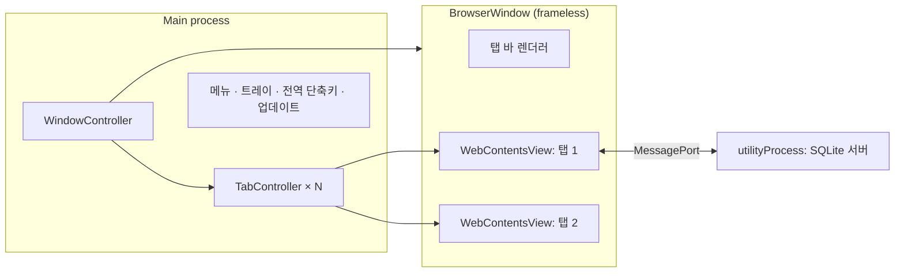

# Notion 데스크톱 앱 구조 분석 요약

Noosion 설계의 근거가 된 분석을 요약한 문서입니다. 대상은 Windows용 Notion 데스크톱 앱 7.34.0(Electron 43.6.0)이고, REA MCP 정적 분석과 로컬 SQLite **스키마**만 사용했습니다.

- Notion의 코드와 에셋, 그리고 앱 번들 속 키와 토큰은 이 저장소에 포함하지 않았습니다.
- 사용자 콘텐츠는 읽지 않았습니다.
- Noosion은 아래 구조를 참고해 처음부터 새로 작성한 독립 구현입니다.

## 1. 요약

1. Notion 데스크톱은 **얇은 Electron 셸**입니다.
   - 탭마다 `WebContentsView`를 하나씩 만들고, 그 안에 원격 웹 클라이언트(`app.notion.com`)를 로드합니다.
   - 에디터와 데이터베이스 UI는 패키지에 들어 있지 않습니다.
2. 패키지(`app.asar`)에 들어 있는 것은 아래와 같습니다.
   - 메인 프로세스: 창/탭, 메뉴, 트레이, 전역 단축키, 딥링크, 업데이트, 크래시 감시
   - 커스텀 탭 바 렌더러
   - `better-sqlite3` 기반 오프라인 캐시(utilityProcess `"Sqlite Server"`)
3. 보안 설정
   - Fuse: `RunAsNode` off, `EnableNodeCliInspectArguments` off, `OnlyLoadAppFromAsar` on, 쿠키 암호화 on
   - 모든 웹 콘텐츠는 `sandbox` + `contextIsolation` 환경에서 돌아갑니다.
   - 렌더러는 `contextBridge`(19개 API)로만 메인 프로세스에 접근합니다.

## 2. 셸 아키텍처

- 정적 분석으로 찾은 항목: BrowserWindow 생성 지점 14곳, `notion:*` IPC 채널 약 285개
  - 채널 영역: 탭/창, 탭 그룹, 내비게이션, UI 상태, 편집, 검색, 알림, 업데이트, 오프라인, 쿠키, 회의록, 진단
- 메뉴
  - File: 새 탭/새 창/탭 닫기/닫은 탭 다시 열기/인쇄
  - Edit: 링크 복사/이름 복사/서식 없이 붙여넣기
  - View: 사이드바/줌/전체 화면
  - History: 뒤로/앞으로
  - Window: 다음/이전 탭
  - Help: 로그, 로컬 데이터 초기화 등
- 단축키: `Ctrl+T/W`, `Ctrl+Shift+T`, `Ctrl+Tab`, `Ctrl+1…9`, `Ctrl+[ ]`, `Ctrl+\`, `Ctrl+L`, `Ctrl+Alt+L`, `Ctrl+Shift+V`, 사용자 지정 전역 단축키
- 탭 기능: 컨텍스트 메뉴(닫기/다른 탭 닫기/복제/링크 복사/고정), 드래그로 순서 변경, 종료 시 세션 복원
- 시스템 통합
  - 트레이: 백그라운드 유지, 로그인 시 실행
  - `notion://` 딥링크
  - `.md` 파일 열기
  - 맞춤법 검사
  - 시스템 다크 모드 연동

## 3. 렌더러 브릿지

| 전역 | 용도 |
|---|---|
| `__electronApi` | 웹 클라이언트 ↔ 셸 (탭, 내비게이션, 테마, 클립보드, 알림 등) |
| `tabsApi` | 탭 바 조작 |
| `__desktopConfig`, `__platform` | 환경 정보 |

Noosion은 이 구조를 단일 브릿지 `window.noosion`(`src/preload/index.ts`)으로 단순화했습니다.

## 4. 동기화 모델 (추론)

- 클라이언트가 트랜잭션을 만듭니다.
  - 형태: `operations: [{ pointer: {table, id}, path, command: set|update|listAfter|listRemove, args }]`
- 트랜잭션을 로컬에 낙관적으로 적용한 뒤 서버에 제출합니다.
- 오프라인일 때는 `transactions` 테이블에 쌓아 두었다가 다시 보냅니다.

Noosion은 서버 없이 같은 개념을 사용합니다. 렌더러가 레코드 쓰기를 묶어 메인 프로세스로 보내고, 메인 프로세스가 JSON 저장소에 원자적으로 기록한 뒤 다른 창에 브로드캐스트합니다.

## 5. 리치 텍스트

`properties.title`은 `[[텍스트, [[코드, 값?], …]], …]` 형태입니다.

| 코드 | 의미 |
|---|---|
| `b` / `i` / `_` / `s` / `c` | 굵게 / 기울임 / 밑줄 / 취소선 / 인라인 코드 |
| `a` | 링크 `["a", url]` |
| `h` | 색상 `["h", "red"]`, `["h", "blue_background"]` |
| `e` / `d` / `p` / `u` | 수식 / 날짜 / 페이지 멘션 / 사용자 멘션 |

## 6. 레코드 데이터 모델

모든 콘텐츠는 `block`입니다. 블록은 `parent_id`(위쪽)와 `content`(아래쪽, 자식 ID 배열 = 표시 순서)로 트리를 이룹니다. 삭제는 `alive=false`로 처리하는 soft delete입니다.

| 테이블 | 주요 필드 |
|---|---|
| `block` | `id, type, properties(JSON), content(ID[]), format(JSON), parent_id, parent_table, alive, created_time, last_edited_time, collection_id, view_ids, moved_to_trash_time` |
| `collection` | `name(RichText), icon, schema: { propId: { name, type, options[] } }` |
| `collection_view` | `type: table/board/list/gallery/calendar/timeline, format(table_properties, board_columns_by, calendar_by, timeline_by …), query2(filter, sort)` |
| `space` | 워크스페이스: `name, icon, pages(최상위 페이지 ID[])` |

- 블록 타입: `text, header, sub_header, sub_sub_header, bulleted_list, numbered_list, to_do, toggle, quote, callout, divider, code, image, bookmark, equation, column_list/column, table/table_row, page, collection_view, collection_view_page`
- `format` 키: `page_icon, page_cover, page_cover_position, page_full_width, page_small_text, page_font, block_locked, block_color, block_width, code_wrap, table_block_column_header`
- 속성 타입: `title, text, number, select, multi_select, status, date, checkbox, person, url, email, phone_number, formula, created_time, last_edited_time`(+ Notion 전용 `relation, rollup, file`)

Noosion의 `src/shared/types.ts`는 이 형태를 그대로 따릅니다.

## 7. 분석 한계

- 웹 클라이언트 코드는 분석 범위 밖이므로, 에디터 동작은 데이터 모델과 문자열에서 역추론한 것입니다.
- 큰 렌더러 번들 일부는 시맨틱 분석이 부분적으로만 이뤄졌습니다(인벤토리는 완전함).
- 런타임 계측은 하지 않았습니다. Fuse로 `--inspect`가 차단되어 있습니다.
